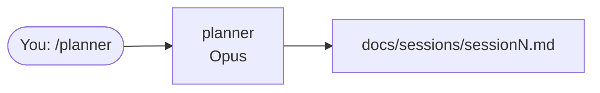
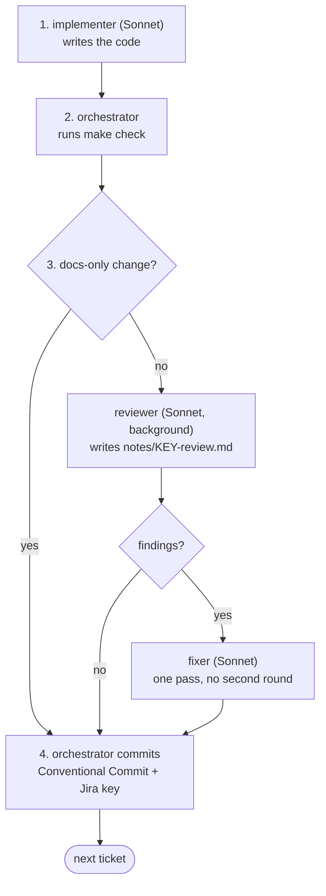
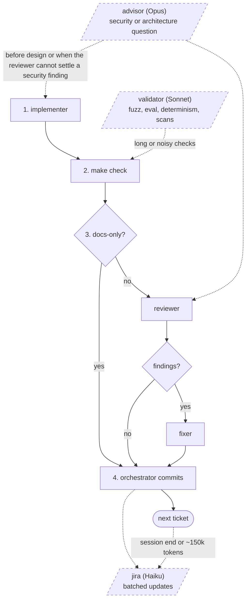

# Agent flow

Binding rules: `.claude/delegation-rules.md`. This page is a readable summary.

## Before the session

## During the session (per ticket)

The orchestrator (Sonnet) repeats this loop for each ticket.

## Optional agents in the flow

Dashed boxes are optional: they run only when their condition is met.

| Optional agent | Model | Spawned when |
|---|---|---|
| validator | Sonnet | Long or noisy checks: fuzz, eval, determinism diffs, secret/HAR scans. Plain `make check` is run by the orchestrator. |
| advisor | Opus | Security or architecture question, written first to `notes/KEY-opus.md`. Also when the reviewer cannot settle a security finding. |
| jira | Haiku | Batched Jira updates at the end of a session or at a restart, not per ticket. |

## Restart

At about 150k tokens (hook warns at 120k) the orchestrator writes a progress shard in `docs/progress/`,
sends the batched Jira updates and stops. You continue with `/resume`.

## Rules of thumb

- Every code change gets a reviewer pass, however small.
- Dependent steps: run in sequence. Parallel only for independent tickets in disjoint directories.
- Prompts to agents: pointers only, at most ~1.5k tokens. Details go to `notes/`.
- Agents never commit or push. Only the orchestrator does.
